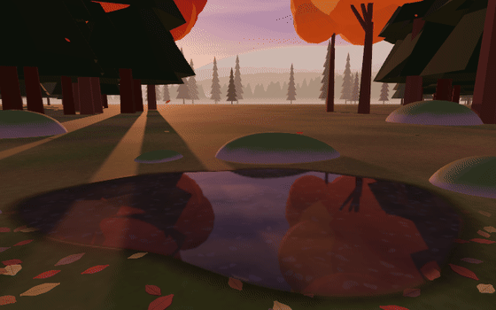
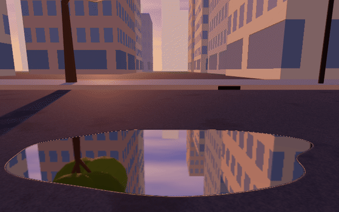
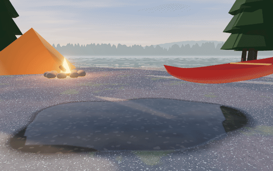

# Puddle

Slap a puddle and watch real waves move.

Puddle is a browser toy built on a GPU solver for the shallow-water equations. Waves, ripples, splashes, floating toys and skipping stones all come from the same physics, in real SI units, at real size: a puddle about 2 m across and 2.5 cm deep.

**Play:** https://marcmasgoret.ca/puddle/ · **Physics write-up:** [physics.html](https://marcmasgoret.ca/puddle/physics.html) · **Validation, live on your GPU:** [validate.html](https://marcmasgoret.ca/puddle/validate.html) · **Every build:** [builds.html](https://marcmasgoret.ca/puddle/builds.html)

<p align="center">
  
</p>
<p align="center">
  
  
</p>

*Real frames from the simulation: water in the forest, mercury in the city, and a skipping stone at Algonquin.*

## What you can do

- **Slap** the water. Hand speed is set by the strength slider, 0.3 to 5 m/s. Hard slaps throw spray, and the spray lands back as drops that make their own ripples.
- **Stir** by dragging, or **press and hold** to push a fingertip in. Move faster than the wave speed and you leave a V-shaped wake; drag through honey and the trench oozes shut.
- **Change the fluid:** water, honey, mercury, oobleck, lava or red jello, each with measured properties. Oobleck goes solid when you hit it; lava glows under a cooling crust that tears where it moves; jello is an elastic gel that jiggles and springs back.
- **Float toys:** a rubber duck, a paper boat, a sailboat and a beach donut, at their real sizes and masses. They ride the waves, get pushed along by them, and make their own.
- **Skip stones** in first person with a side-arm swipe. About 20° of tilt is the magic angle.
- **Fish** with the tip of a rod just in view: cast, then watch the bobber. Nothing is ever caught.
- **Drive an RC boat** with the thumb stick or the arrow keys. Faster than the waves, it drags a V-shaped wake.
- **Choose the puddle size:** small (half the usual), normal, or large (twice the usual, and deeper).
- **Pick a place:** forest, the PEI dunes, a sandy beach with palms, a city street in Toronto, a backyard pool, a cottage dock, High Park, the Lions Gate Bridge, or an Algonquin canoe camp. Change the season, time of day and weather. Rain, gusts of wind, autumn leaves and winter ice all act on the water. At night there are stars, a moon and city lights.
- **Watch the wildlife:** sculpted, skinned animals with real gaits: robins, crows, gulls, geese, mallards, loons, squirrels, cottontails, a doe, a fox, leaping bass, and once in a while a tabby cat stalking a mouse.
- **Listen:** generative music for each season (flute and birdlike trills in spring, guitar and hand drum in summer, a wistful minor autumn, music-box carols in winter) and a nature soundscape for each place and time of day: thrushes and wrens in the forest, loons across the lake at the cottage, gulls and breaking waves at the beaches. All synthesised live; music and nature have their own volume.
- **Engineering mode** (in the settings panel; it switches to slapping):
  - overlays of surface height, velocity, vorticity, Froude number, strain rate and viscosity, and the forces on each toy;
  - live readouts of the solver, and sliders for every physical parameter, including gravity;
  - a choice of grid resolution.

## The physics, briefly

The water is a thin layer, so its motion is described by the **shallow-water equations** for the surface height η and the depth-averaged velocity **u**:

```
∂η/∂t + ∇·(h u) = 0
∂u/∂t + (u·∇)u = −g∇η − ∇p_s/ρ + (σ/ρ)∇(∇²η) + ν_eff∇²u − c_f u + τ_w/(ρh)
```

The terms on the right are gravity, surface pressure, surface tension, viscosity with a Smagorinsky turbulence model, bed friction (a Stokes boundary layer or Poiseuille flow, whichever applies) and wind stress.

**Numerics:**
- staggered (Arakawa C) grid of 512 × 367 cells on desktop and 256 × 184 on phones;
- forward–backward time stepping, so waves are neither amplified nor damped by the scheme;
- momentum-conserving advection (Stelling & Duinmeijer 2003), so bores run at the right speed;
- implicit friction;
- conservative fluxes with a positivity-preserving limiter, so volume is conserved to round-off;
- substeps sized from a von Neumann stability bound.

**Models on top of the solver:**
- **Oobleck:** a shear-thickening viscosity μ(γ̇), after Fall et al. (2012) and Brown & Jaeger (2014).
- **Slaps:** the momentum J = ⁴⁄₃ρa³V of Glasheen & McMahon (1996). Above Froude 1 the excess becomes spray, scaled by the Ohnesorge number.
- **Toys:** rigid bodies with Archimedes buoyancy, drag and wave-radiation damping. They push back on the water through pressure loads.
- **Stone skipping:** Bocquet's (2003) model, with spin-stabilised tilt.

**Rendering:** Snell refraction, exact Fresnel reflectance (dielectric, and conductor for mercury), Beer–Lambert absorption and area-ratio caustics, all computed from the simulated surface.

The [physics write-up](docs/physics.md) has every equation, the discretisation, the stability analysis, the assumptions and limitations, and references.

## Validation

The [validation page](https://marcmasgoret.ca/puddle/validate.html) runs the production solver in flat test tanks against analytical results, on your own GPU. Results at Δx = 9 mm:

| Test | Compared with | Worst error |
|---|---|---|
| Wave speed, 5–30 mm deep | √(gH) | 0.25 % |
| Standing waves, 2.3 m to 4 cm long | the scheme's discrete dispersion relation (gravity + capillary) | 0.04 % |
| Damping, water-like to honey | Stokes-layer and Poiseuille bed friction | 0.7 % |
| Volume, 20 hard slaps past Froude 1 | exact conservation | 4 × 10⁻⁸ of the puddle |
| Dam break, 20 mm onto 5 mm | Stoker's exact solution | bore position 0.3 % |

Section 10 of the [write-up](docs/physics.md) has the full tables. It also covers the bug the dam-break test caught: the first version's bore was 13 % slow, and the fix was momentum-conserving advection.

## Architecture

```
src/
  physics/           the simulation (heavily commented; every equation explained)
    fluids.ts          measured properties of water, honey, mercury, oobleck
    grid.ts            the staggered grid
    puddleShape.ts     signed-distance edge and bowl-shaped floor
    swe/shaders.ts     the equations, as GPU passes
    stability.ts       time-step selection from the von Neumann bound
    solver.ts          ping-pong render targets, substeps, impulses
    rheology.ts        oobleck's shear-thickening viscosity
    slap.ts            hand impact: momentum, Froude cap, spray
    droplets.ts        ballistic drops with drag
    rigidbody.ts       buoyancy, drag, radiation damping
    skipping.ts        Bocquet stone-skipping model
    pressureMap.ts     loads from fingers, toys and wind on the surface
  render/            water optics, caustics, ground, wet map, overlays
  scene/             camera, toys, stones, fishing, locations, weather, animals
  audio/             Web Audio synthesis
  ui/                settings panel, toy drawer, engineering mode
  validate/          the validation tests and their analytical solutions
  docs/              the physics page renderer
docs/physics.md      the write-up (rendered at physics.html)
```

Each frame:
1. Toys, stones, fingers and weather produce pressure loads and impulses.
2. The solver runs N substeps of velocity, limiter and height passes on the GPU.
3. A surface pass packs η and its gradient for rendering.
4. Toys read the fluid back asynchronously.
5. Caustics are traced.
6. The scene, its planar reflection and the water are rendered, then bloom and tone mapping are applied.

## Run locally

You need [Node.js](https://nodejs.org) 20 or newer.

```
npm install
npm run dev
```

Then open http://localhost:5173/puddle/.

**Useful URL options:**
- `?grid=256` sets the grid resolution.
- `?eng` opens engineering mode.

`npm run build` type-checks and builds all three pages into `dist/`.

Every push to `main` deploys through GitHub Actions. It publishes the latest build and a frozen copy of every commit, listed at `builds.html`.

## Credits

There are no third-party art or audio assets; everything is generated in code. See [CREDITS.md](CREDITS.md) for libraries and scientific sources.
